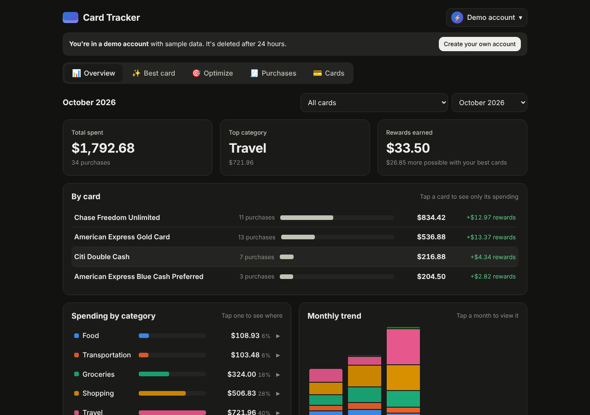

# Card Tracker


**See where your money goes, and which credit card earns you the most.**

Live: **https://card-tracker-three-steel.vercel.app** (click **Try the demo**, no sign-up needed)



## What it does

- **Tracks your spending.** Upload your card's PDF statement or CSV file, or add purchases by hand. PDFs show a review screen first, with a check that the totals match the statement. Each purchase is sorted into a category (food, groceries, travel, subscriptions, and more). Tap a category to see every store and purchase.
- **Picks the best card.** Type a store and an amount, and it tells you which of your cards pays the most back.
- **Finds a better setup.** Based on how you actually spend, it shows what your cards earn per year after fees, and which card would earn you more if you added it.
- **Knows 18 popular cards.** Amex, Chase, Capital One, Citi, Discover, Bank of America, Apple, Robinhood and more. Pick yours and the reward rules fill in.
- **Handles the tricky rules.** Spending caps, caps shared between categories, and 5% categories that change every quarter.
- **Works on your phone.**

## How it's built

| Part | Tools |
|---|---|
| Backend | Python, FastAPI, SQLAlchemy |
| Frontend | React, Vite |
| Database | PostgreSQL (Neon); SQLite on your own computer |
| Hosting | Vercel |
| Tests | pytest |

Main pieces of the code:

| File | What it does |
|---|---|
| `backend/app/categories.py` | Decides each purchase's category from the store name |
| `backend/app/sources/` | Ways purchases come in: PDF statements, CSV files, typed in by hand, sample data |
| `backend/app/recommendation.py` | Ranks your cards for one purchase |
| `backend/app/optimizer.py` | Works out yearly rewards and which cards to add |
| `backend/app/catalog/cards.json` | The 18 cards and their reward rules |
| `backend/app/auth.py` | Accounts, passwords and logins |
| `frontend/src/components/` | The screens: Overview, Best card, Optimize, Purchases, Cards |

## Keeping accounts safe

- **Passwords are never saved as text.** Only a scrambled version (Argon2) is stored.
- **Logins use a secure cookie** that the page's scripts can't read. The database only keeps a scrambled copy of it.
- **Your data is only yours.** Every request checks that the data belongs to the person logged in. Tests prove one user can't see another's data.
- **Guessing passwords gets blocked.** Too many wrong tries locks that email for 15 minutes.
- **Forgot password** sends a link that works once and expires in 30 minutes.
- **Only an email is needed.** No card numbers, ever. You can delete your account and all your data at any time.

## Run it on your computer

You need Python 3.10+ and Node.js 18+.

```bash
./start.sh
```

Then open http://localhost:5173. The first run installs everything.

## Run the tests

```bash
cd backend
source venv/bin/activate
pip install -r requirements-dev.txt
python -m pytest
```

## Put it online

See [DEPLOY.md](DEPLOY.md) for the free setup on Vercel and Neon.

## What's next

- Link bank accounts automatically with Plaid
- Track card perks and credits you haven't used yet
